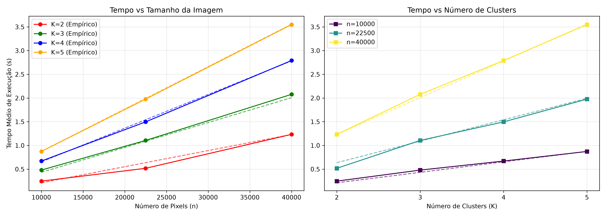
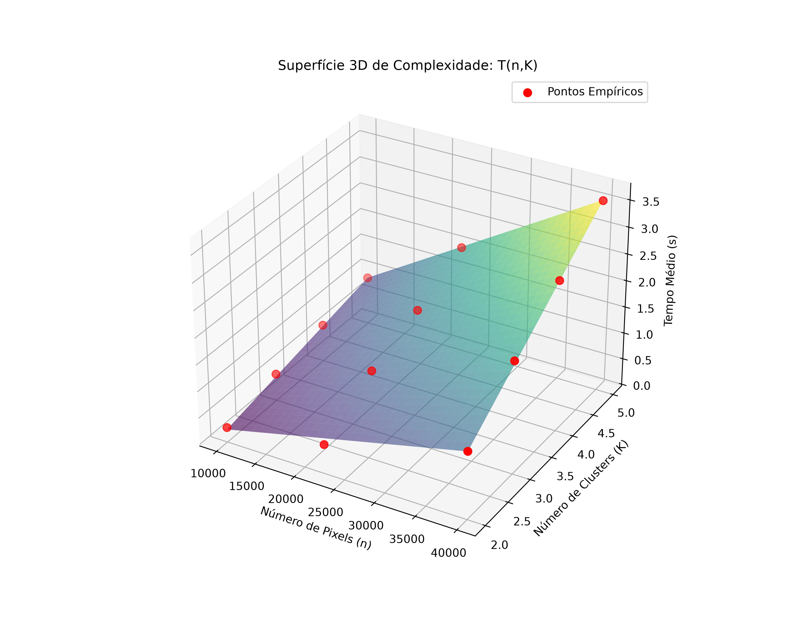

# FCM Puro — Otimização e Análise Empírica de Complexidade

> Implementação do **Fuzzy C-Means (FCM)** em Python puro para segmentação de imagens, com a otimização **Early Exit (Poda Condicional)** e um *benchmark* estatístico que modela empiricamente o tempo de execução **T(n, K)**.


---

## Sumário

- [Visão geral](#visão-geral)
- [Principais características](#principais-características)
- [Estrutura do repositório](#estrutura-do-repositório)
- [Instalação](#instalação)
- [Como usar](#como-usar)
- [Fundamentação do algoritmo](#fundamentação-do-algoritmo)
- [Missão 5: Early Exit](#missão-5-early-exit-poda-condicional)
- [Metodologia experimental](#metodologia-experimental)
- [Resultados](#resultados)
- [Limitações conhecidas](#limitações-conhecidas)
- [Roadmap](#roadmap)
- [Contribuindo](#contribuindo)
- [Licença](#licença)
- [Autores](#autores)

---

## Visão geral

Este projeto nasceu de uma atividade prática de **otimização de código e análise de desempenho**. A base é uma implementação deliberadamente **"pura"** do algoritmo FCM (listas aninhadas, laços explícitos, sem vetorização), usada como linha de base para aplicar técnicas clássicas de otimização de baixo nível, cada uma delas atribuída a uma "missão":

| Missão | Técnica | Descrição |
|:------:|---------|-----------|
| 1 | Memory Flattening | Achatar a matriz de pertinência `U` (N×K) em um vetor 1D |
| 2 | Fixed-Point Math | Substituir `float` por aritmética de ponto fixo com *shifts* (`>>`) |
| 3 | Structure of Arrays (SoA) | Separar os canais R, G e B em três listas independentes |
| 4 | Loop Unrolling | Desdobrar manualmente o laço dos canais de cor |
| **5** | **Early Exit (Poda Condicional)** | **Interromper o cálculo de distâncias acima de um limiar** *(implementada neste repositório)* |
| 6 | Loop Fission | Separar o cálculo de distâncias e o de pertinências em dois laços |

Além da otimização, o repositório traz um **experimentador** que mede o tempo de execução em função do número de pixels (`n`) e de clusters (`K`), valida a estabilidade das medições e ajusta um modelo matemático aos dados.

## Principais características

- **FCM de referência em Python puro**, com proteções contra divisão por zero e índices inválidos.
- **Variante com Early Exit** (`fcm_early_exit.py`) que poda o cálculo de distâncias para clusters muito distantes.
- **Bancada de testes automatizada** (`experimentador.py`) com:
  - varredura automática de imagens por tamanho crescente;
  - 30 repetições por configuração (`R = 30`);
  - filtragem de *outliers* pelos percentis 5 e 95;
  - **trava *Fail-Fast***: o experimento é abortado se o Coeficiente de Variação (CV) for ≥ 15 %;
  - ajuste não linear de curva por mínimos quadrados (`scipy.optimize.curve_fit`) e cálculo de R².
- **Visualizações prontas**: gráficos 2D e superfície 3D do modelo ajustado.
- **Relatório reproduzível** em Jupyter Notebook (`relatorio_fcm.ipynb`).
- Exportação dos resultados em CSV.

## Estrutura do repositório

```text
.
├── FCM_PURO_v3.py              # FCM puro (linha de base)
├── fcm_early_exit.py           # FCM com Early Exit (Missão 5)
├── experimentador.py           # Bancada de testes + ajuste de curva + gráficos
├── redimensionar.py            # Utilitário para gerar imagens com n pixels desejado
├── relatorio_fcm.ipynb         # Relatório final (metodologia, modelo e conclusão)
├── resultados_foca_aluno.csv   # Resumo estatístico das medições
├── relatorio_complexidade.png  # Gráficos 2D: T × n e T × K
├── superficie_3d.png           # Superfície 3D do modelo T(n, K)
└── minhas_imagens/
    ├── imagem_100x100.png      # Imagens de entrada (n = 10.000, 22.500, 40.000)
    ├── imagem_150x150.png
    ├── imagem_200x200.png
    └── segmentadas_<imagem>/   # Saídas: K{k}_R0.png (primeira repetição de cada K)
```

## Instalação

**Pré-requisitos:** Python 3.12 (ou superior) e `pip`.

```bash
# 1. Clone o repositório
git clone https://github.com/<seu-usuario>/<seu-repositorio>.git
cd <seu-repositorio>

# 2. Crie e ative um ambiente virtual
python -m venv venv
source venv/bin/activate        # Linux/macOS
venv\Scripts\activate           # Windows

# 3. Instale as dependências
pip install numpy pandas matplotlib pillow scipy

# 4. (Opcional) Para executar o notebook
pip install jupyter ipykernel
```

## Como usar

### 1. Segmentar uma única imagem

Edite as variáveis no bloco `__main__` de `FCM_PURO_v3.py` (`imagem_entrada`, `K_clusters`, `fator_m`, `iteracoes_max`, `limite_epsilon`) e execute:

```bash
python FCM_PURO_v3.py
```

Ou use a função diretamente:

```python
from PIL import Image
from FCM_PURO_v3 import fcm_processar_imagem        # versão pura
# from fcm_early_exit import fcm_early_exit         # versão com Early Exit

img = Image.open("minhas_imagens/imagem_100x100.png").convert("RGB")

centroides, pertinencias, imagem_segmentada = fcm_processar_imagem(
    img, K=4, m=2.0, max_iter=100, epsilon=0.01
)
```

**Retorno:** `C` (centroides K×3), `U` (matriz de pertinência N×K) e a imagem segmentada como `numpy.ndarray`. Cada cluster é pintado com uma cor de uma paleta fixa de 6 cores.

### 2. Gerar as imagens de teste

O script `redimensionar.py` redimensiona três imagens de origem para 100×100, 150×150 e 200×200 (n = 10.000, 22.500 e 40.000). Coloque seus arquivos em `minhas_imagens/` com os nomes `img1.png`, `img2.png` e `img3.png` (ou ajuste a lista no script) e execute:

```bash
python redimensionar.py
```

### 3. Executar o experimento completo

```bash
python experimentador.py
```

O script irá: mapear as imagens em `./minhas_imagens`, executar `R = 30` repetições para cada combinação `(n, K)` com `K ∈ {2, 3, 4, 5}`, validar o CV, ajustar o modelo e gerar `relatorio_complexidade.png`, `superficie_3d.png` e `resultados_foca_aluno.csv`.

> ⏱️ Na execução registrada no notebook, o experimento completo levou cerca de **513 segundos**.

### 4. Alternar entre FCM puro e Early Exit no benchmark

A função `segmenta_imagem` em `experimentador.py` contém as duas chamadas; basta comentar/descomentar a desejada:

```python
# Early Exit (Missão 5)
# centroides, matriz_u, seg_img = fcm_early_exit(img_obj, k, max_iter=15)

# FCM puro (linha de base)
centroides, matriz_u, seg_img = fcm_processar_imagem(img_obj, k, max_iter=15)
```

## Fundamentação do algoritmo

O FCM minimiza a função objetivo

```
J_m = Σᵢ Σⱼ  uᵢⱼᵐ · ‖xᵢ − cⱼ‖²
```

onde `xᵢ` é o vetor RGB do pixel *i*, `cⱼ` é o centroide do cluster *j*, `uᵢⱼ` é o grau de pertinência e `m > 1` é o fator de fuzzificação (padrão: `m = 2`).

A cada iteração:

1. **Centroides:** `cⱼ = Σᵢ uᵢⱼᵐ · xᵢ / Σᵢ uᵢⱼᵐ`
2. **Pertinências:** `uᵢⱼ = 1 / Σₖ ( ‖xᵢ − cⱼ‖ / ‖xᵢ − cₖ‖ )^(2/(m−1))`
3. **Convergência:** o laço termina quando `max |uᵢⱼ(novo) − uᵢⱼ(antigo)| < ε` ou ao atingir `max_iter`.

Ao final, cada pixel é atribuído ao cluster de **maior pertinência** e colorido com a cor correspondente da paleta.

**Complexidade teórica por iteração:** `O(n · K · C)`, em que `n` é o número de pixels, `K` o número de clusters e `C = 3` canais.

## Missão 5: Early Exit (Poda Condicional)

Em `fcm_early_exit.py`, dentro do laço que calcula a distância de cada pixel a cada centroide, foi injetado um desvio condicional:

```python
LIMITE_ARBITRARIO = 150.0

if distancias[j] > LIMITE_ARBITRARIO:
    for k_resto in range(j, K):
        distancias[k_resto] = 999999.0   # "distância infinita" para os clusters restantes
    break                                # poda condicional
```

**Salvaguarda:** sem o preenchimento das posições restantes com um valor grande, os clusters não avaliados permaneceriam com distância `0.0`, o que acionaria incorretamente o caso especial de "pixel exatamente sobre o centroide" (pertinência 1,0).

> ⚠️ **Trade-off:** a poda é uma **aproximação**. Ela reduz trabalho, mas pode alterar as pertinências e, portanto, a segmentação final em relação ao FCM puro. O limiar `150.0` (distância euclidiana no espaço RGB, máximo teórico ≈ 441,7) é arbitrário e deve ser calibrado conforme a aplicação.

## Metodologia experimental

| Item | Configuração |
|------|--------------|
| Tamanhos de imagem (`n`) | 10.000 (100×100), 22.500 (150×150) e 40.000 (200×200) pixels |
| Número de clusters (`K`) | 2, 3, 4 e 5 |
| Repetições por configuração (`R`) | 30 |
| Limite de iterações (`max_iter`) | 15 (para manter o tempo de teste viável) |
| Medição de tempo | `time.perf_counter()` |
| Tratamento de *outliers* | Descarte fora do intervalo [P5, P95] (26 de 30 amostras válidas por configuração) |
| Critério de estabilidade | CV = desvio / média **< 0,15** (*Fail-Fast* caso contrário) |
| Modelo ajustado | `T(n, K) = α·(n·K) + β·n + γ·K + δ` |
| Método de ajuste | Mínimos quadrados não lineares (`scipy.optimize.curve_fit`) |
| Métrica de aderência | Coeficiente de determinação R² |

## Resultados

### Estabilidade das medições

Todas as 12 configurações `(n, K)` passaram no critério de estabilidade. O maior CV observado foi **0,115** (n = 10.000, K = 2).

### Tempos médios de execução (segundos)

| n \ K | 2 | 3 | 4 | 5 |
|------:|:-----:|:-----:|:-----:|:-----:|
| **10.000** | 0,248 | 0,481 | 0,671 | 0,873 |
| **22.500** | 0,518 | 1,106 | 1,497 | 1,977 |
| **40.000** | 1,234 | 2,078 | 2,791 | 3,549 |

Os dados completos (desvio-padrão, CV, contagem válida e tempo predito) estão em [`resultados_foca_aluno.csv`](resultados_foca_aluno.csv) — *separador `;` e decimal `,`*.

### Modelo ajustado

```
T(n, K) = (1,7851·10⁻⁵)·(n·K) + (−3,6025·10⁻⁶)·n + (4,1348·10⁻²)·K + (−2,0876·10⁻¹)
```

| Parâmetro | Valor | Unidade |
|-----------|------:|---------|
| α | 1,785·10⁻⁵ | s / (pixel · cluster) |
| β | −3,603·10⁻⁶ | s / pixel |
| γ | 4,135·10⁻² | s / cluster |
| δ | −2,088·10⁻¹ | s |

**R² = 0,9974.** O termo dominante é `α·(n·K)`, o que confirma o comportamento esperado: o tempo cresce de forma aproximadamente **linear em `n`** e **linear em `K`**, com forte interação entre ambos.

### Gráficos



*Linhas contínuas: medições empíricas. Linhas tracejadas: modelo ajustado.*



*Superfície do modelo T(n, K) com as medições empíricas (pontos vermelhos).*

## Limitações conhecidas

- **Poucos pontos de ajuste:** o modelo de 4 parâmetros foi ajustado com apenas 12 pontos (3 valores de `n` × 4 de `K`). Os coeficientes `β` e `δ` negativos não têm interpretação física direta e devem ser lidos como termos de correção do ajuste, não como tempos reais.
- **Erro do modelo em pontos específicos:** o desvio relativo entre o tempo predito e o medido chega a ~23 % em (n = 22.500, K = 2) e ~14 % em (n = 10.000, K = 2); nos demais pontos fica, em geral, abaixo de 4 %.
- **Reprodutibilidade:** a inicialização de `U` usa `random.random()` sem semente fixa, então o número de iterações até a convergência varia entre execuções. Para resultados determinísticos, adicione `random.seed(<valor>)`.
- **Teto de iterações:** o benchmark usa `max_iter = 15`; em algumas execuções o algoritmo atinge esse limite antes de convergir (`ε = 0,01`).
- **Resultados específicos de hardware:** os coeficientes refletem a CPU e o interpretador Python usados. Em outra máquina, os valores absolutos mudarão.
- **Early Exit com limiar fixo:** o valor `150.0` não foi calibrado nem validado quanto à qualidade da segmentação.
- **Desempenho:** a implementação em Python puro é intencionalmente lenta e didática; não é indicada para imagens grandes.

## Roadmap

- [ ] Fixar semente aleatória e registrar a versão do Python/CPU no relatório
- [ ] Comparar lado a lado FCM puro × Early Exit (tempo **e** qualidade da segmentação)
- [ ] Calibrar o limiar do Early Exit
- [ ] Aumentar o número de tamanhos de imagem para robustecer o ajuste de curva
- [ ] Implementar as demais missões (1, 2, 3, 4 e 6)
- [ ] Adicionar versão vetorizada em NumPy como referência de desempenho
- [ ] Adicionar `requirements.txt` e testes automatizados

## Contribuindo

Contribuições são bem-vindas!

1. Faça um *fork* do projeto
2. Crie uma *branch* (`git checkout -b feature/minha-melhoria`)
3. Faça o *commit* (`git commit -m "feat: descreve a melhoria"`)
4. Envie para o seu *fork* (`git push origin feature/minha-melhoria`)
5. Abra um *Pull Request*


> Projeto desenvolvido para fins acadêmicos na disciplina de Engenharia de Programas — UNEB.
